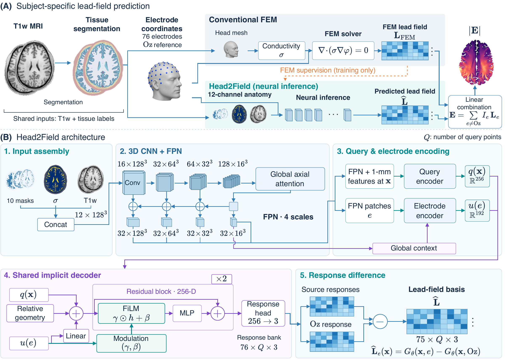

<div align="center">

# Head2Field

[English](README.md) · [简体中文](README_zh.md)

**Continuous neural fields for subject-specific tES lead-field prediction.**

[](pyproject.toml)
[](pyproject.toml)
[](docs/en/preprocessing.md)
[](LICENSE_GUIDE.md)

[Installation](#installation) · [Quick start](#quick-start) · [Documentation](#documentation) · [Reproduction](#reproduction) · [Citation](#citation)

🧠 **Structural MRI** · ⚡ **Continuous neural fields** · 🧭 **World-RAS vectors** · 🔬 **Physics-guided training**

</div>

Head2Field predicts a reusable, multi-electrode electric-field basis from
T1-derived head anatomy, tissue conductivity, and electrode coordinates.
Shared electrode responses support field synthesis across current patterns
without montage-specific retraining.

<div align="center">

[](docs/assets/head2field-overview.pdf)

**Method overview.** (A) Subject-specific lead-field prediction and field
synthesis. (B) Multiscale anatomical encoding, electrode-conditioned decoding,
and shared-response differences. Click the figure for the vector PDF.

</div>

---

## 📚 Explore Head2Field

[🚀 Install](#installation) · [⚡ Predict fields](#quick-start) · [🧪 Train a model](#reproduction) · [📖 Read the docs](#documentation)

## 📄 Paper

This repository is the **official implementation** of the manuscript:

> **Head2Field: A Continuous Neural Field for Subject-Specific Multi-Electrode
> Transcranial Electrical Stimulation Lead-Field Prediction from Structural
> MRI**

The current model is **Head2Field v1** (`Head2FieldV1`), configured in
[head2field_v1.json](configs/head2field_v1.json). The PyTorch implementation
covers preprocessing, FEM supervision, training, and inference.
Its output is a `[75, Q, 3]` basis at GM/WM query locations:
75 source-to-Oz maps, world-RAS `[Ex, Ey, Ez]`, in `V/m` for source `+1 mA`
and Oz `-1 mA`. See the [model card](MODEL_CARD.md) for research use,
assumptions, and limitations.

## ✨ Features

| Workflow | Capability | Requirements |
| --- | --- | --- |
| Inference | Prepared head inputs and model weights to 75 lead-field maps; no FEM labels required | Base installation |
| Preprocessing | T1 canonicalization, external CHARM head modeling, tissue conductivity, GM/WM queries, and standard electrode cap | `preprocess` extra and SimNIBS 4.6.0 |
| FEM labels | Oz-referenced lead-field generation, HDF5 validation, and voxel-label export | `fem` extra and SimNIBS 4.6.0 |
| Training | Data and physics losses, complete epochs, validation, early stopping, and local resume | `training` extra and CUDA-enabled PyTorch |

<a id="installation"></a>

## 🚀 Installation

Use Python 3.11 or newer. Install the downloaded wheel, which includes the
pretrained Head2Field v1 weights:

```bash
python -m pip install head2field-0.1.0rc1-py3-none-any.whl
head2field-predict --help
```

To install from source, run this in the repository root:

```bash
python -m pip install .
```

For optional preprocessing and FEM dependencies, install the local wheel with:

```bash
python -m pip install './head2field-0.1.0rc1-py3-none-any.whl[full]'
```

From a source checkout, select the workflows as needed:

```bash
python -m pip install '.[preprocess]'
python -m pip install '.[fem]'
python -m pip install '.[training]'
python -m pip install '.[full]'
```

Install SimNIBS/CHARM **4.6.0** separately for preprocessing and FEM labels.
Real-data training requires CUDA-enabled PyTorch. The `training` extra marks
that workflow; its Python dependencies are already in the base installation.
The `full` extra adds SciPy and h5py.

The [getting-started guide](docs/en/getting_started.md) covers the complete installed
workflow, CUDA checks, bundled configuration access, and common setup issues.

<a id="quick-start"></a>

## ⚡ Quick start

### Predict lead fields

Supply a [prepared subject](docs/en/input_contract.md). The command loads the
[bundled pretrained v1 weights](weights/README.md) automatically.

```bash
head2field-predict \
  --prepared-subject prepared_subject \
  --output-dir prediction \
  --device cpu
```

Use `--device cuda` for GPU inference. The output includes
`lead_field_float32.npy` with shape `[75, Q, 3]`, exact query coordinates,
electrode-pair records, and a manifest with input/output metadata. Vector
components are `[Ex, Ey, Ez]` in world-RAS; field values are in `V/m` under the
fixed 1 mA current convention. See [inference](docs/en/inference.md) for chunking
and the Python API.

Use `--weights /path/to/custom_v1.pth` to select your own compatible weights.

### Prepare a raw T1 image

```bash
head2field-prepare \
  --input-t1 raw_t1.nii.gz \
  --profile non_hcp_raw \
  --template orientation_template.nii.gz \
  --canonical-output-dir canonical_stage \
  --head-model-output-dir charm_head_model \
  --prepared-output-dir prepared_subject
```

`non_hcp_raw` performs one 6-DOF rigid alignment; inspect its QC image before
using the prepared subject. For an already ACPC-aligned, distortion-corrected
HCP input, use `hcp_acpc`, which skips rigid estimation. All generated output
directories must be new. See [preprocessing](docs/en/preprocessing.md).

### Check the training installation with synthetic data

The following example runs a small CPU FP32 model without participant data or
SimNIBS.

The commands use the checkout's `configs/` files. After a wheel-only install,
[copy the bundled defaults](docs/en/getting_started.md#configuration-files-after-wheel-installation)
into your working directory first.

```bash
head2field-make-synthetic-training --output-dir generated/synthetic-training

head2field-train-preflight \
  --config configs/training_smoke_v1.json \
  --synthetic-dataset generated/synthetic-training/synthetic_training_dataset_v1.json

head2field-train \
  --config configs/training_smoke_v1.json \
  --synthetic-dataset generated/synthetic-training/synthetic_training_dataset_v1.json \
  --output-dir generated/synthetic-run
```

These analytic, non-anatomical inputs check software operation. They do not
measure prediction accuracy. More examples are in [examples](examples/README.md).

<a id="reproduction"></a>

## 🧪 Training

The default [training_v1.json](configs/training_v1.json) uses
AdamW (`2e-4`, weight decay `1e-4`), CUDA FP16, eight source pairs and 49,152
queries per step. Complete epochs use a maximum 25-epoch cosine schedule,
epoch-end validation, and five-epoch early stopping. The validation-best model
is selected for testing.

The data objective uses 50/100 mm radial regions. [Training and resume](docs/en/training.md)
covers dataset preparation and checkpoints; [reproducibility](docs/en/paper_reproduction.md)
describes model assets, evaluation definitions, and timing scope. Participant
data and cohort splits are obtained separately.

<a id="documentation"></a>

## 📖 Documentation

- [Documentation index](docs/en/README.md)
- [Getting started: installation to prediction](docs/en/getting_started.md)
- [Input format and coordinate conventions](docs/en/input_contract.md)
- [T1 preprocessing and CHARM integration](docs/en/preprocessing.md)
- [FEM label generation and validation](docs/en/fem_label_generation.md)
- [Training, validation, and resume](docs/en/training.md)
- [Inference and output format](docs/en/inference.md)
- [Model architecture](docs/en/model_architecture.md)
- [Reproducibility and evaluation](docs/en/paper_reproduction.md)
- [Machine-readable data contracts](docs/en/data_contracts.md)
- [Code guide: modules, tensor shapes, and execution flow](docs/en/code_guide.md)
- [Model card](MODEL_CARD.md), [data use](DATA_USE.md), and [weight format](weights/README.md)

## 🤝 Contributing

See [CONTRIBUTING.md](CONTRIBUTING.md) for development and verification,
[SOURCE_PROVENANCE.md](SOURCE_PROVENANCE.md) for implementation origins, and
[CHANGELOG.md](CHANGELOG.md) for changes. Synthetic examples check software
behavior; reproducing paper results requires the corresponding data, weights,
and evaluation protocol. Maintainers can use the [release checklist](RELEASE_CHECKLIST.md).

Source comments, docstrings, and CLI help use English. All public guides have
English and Simplified Chinese versions, with a language switch on each page.

<a id="citation"></a>

## 📝 Citation and license

The source code is licensed under [GPL-3.0-only](LICENSE_GUIDE.md). For third-party
software and bundled model-weight provenance, see
[THIRD_PARTY_NOTICES.md](THIRD_PARTY_NOTICES.md) and [DATA_USE.md](DATA_USE.md).

If you use Head2Field in research, cite the manuscript with this BibTeX entry:

```bibtex
@misc{chen_head2field,
  author = {Chen, Xiayu and Wang, Xiaoxiao and Cao, Zixin and
            Liu, Senlin and Liu, Zhichen and Wang, Zhengyang and
            Du, Huiyu and Qiu, Bensheng and Wang, Yanming},
  title  = {{Head2Field}: A Continuous Neural Field for Subject-Specific
            Multi-Electrode Transcranial Electrical Stimulation
            Lead-Field Prediction from Structural {MRI}},
  note   = {Manuscript}
}
```

The title and author order match [CITATION.cff](CITATION.cff). Publication year,
journal, and DOI are not yet recorded there. See the
[citation guide](CITATION_GUIDE.md) for software citation and the relevant methods
and data sources.

Model development benefited from WU-Minn Human Connectome Project data;
[DATA_USE.md](DATA_USE.md) provides the acknowledgement and citation requirements.
