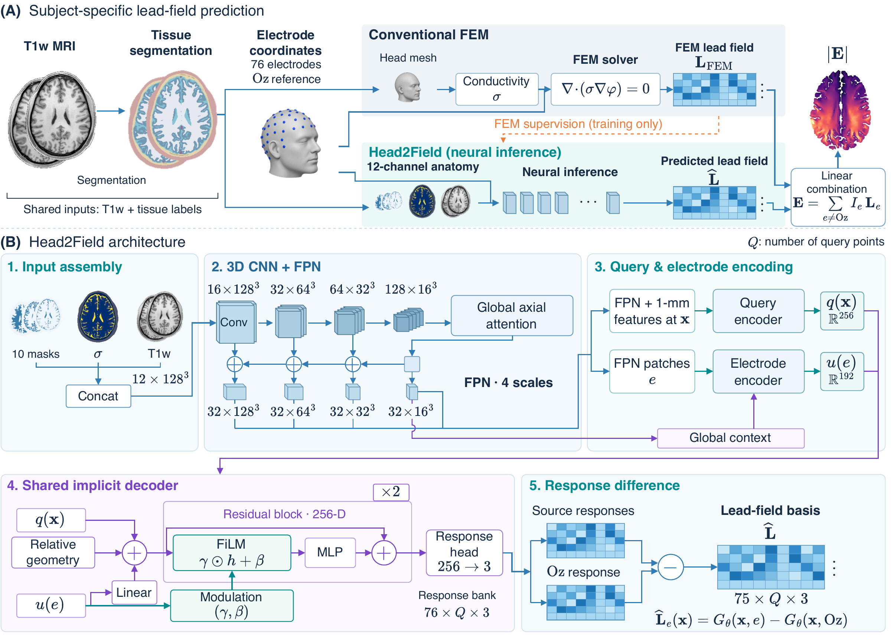

<div align="center">

# Head2Field

[English](README.md) · [简体中文](README_zh.md)

从结构 MRI 预测个体特异性多电极 TES 先导场的连续神经场。

[](https://github.com/ayakacxy/head2field/releases/tag/v0.1.0)
[](pyproject.toml)
[](pyproject.toml)
[](docs/zh/preprocessing.md)
[](docs/LICENSE_GUIDE_zh.md)

[快速上手](#quick-start) · [文档](#documentation) · [训练与评估](#reproduction) · [引用](#citation)

🧠 **结构 MRI** · ⚡ **连续神经场** · 🧭 **World-RAS** · 🔬 **物理引导训练**

[](docs/assets/head2field-overview.pdf)

*图 1：A，先导场预测流程；B，模型结构。点击主图查看 PDF。*

</div>

Head2Field 根据 T1 MRI 提取的头部结构、组织电导率和电极坐标，预测个体的多电极先导场。
得到电场基底后，只需改变各电极的电流系数，就能计算不同刺激方案的电场，无需为每种方案重新训练。

## 📚 目录

[论文](#paper) · [主要功能](#features) · [安装](#installation) · [快速上手](#quick-start) · [训练与评估](#reproduction) · [文档导航](#documentation) · [贡献](#contributing) · [引用与许可证](#citation)

<a id="paper"></a>

## 📄 论文

本项目是以下论文的**官方实现**：

> **Head2Field: A Continuous Neural Field for Subject-Specific Multi-Electrode
> Transcranial Electrical Stimulation Lead-Field Prediction from Structural
> MRI**

中文参考译名：**Head2Field：从结构 MRI 预测个体特异性多电极 tES 先导场的连续神经场**。

安装包提供 **Head2Field v1**（`Head2FieldV1`）、预训练权重，以及预处理、FEM 标签生成、训练和推理命令。
模型配置见 [head2field_v1.json](configs/head2field_v1.json)，Python 包名为 `head2field`。
数据划分、FEM 对比和计时方法见[评估与可重复实验](docs/zh/paper_reproduction.md)。

<a id="features"></a>

## 🧩 主要功能

模型在灰质和白质的 `Q` 个查询位置输出 75 个源电极到 Oz 的电场，数组形状为 `[75, Q, 3]`。
向量分量按 world-RAS `[Ex, Ey, Ez]` 排列，单位为 `V/m`；每个电场对应源电极 `+1 mA`、
Oz `-1 mA`。模型用于非临床科研，训练设置、适用条件与限制见[模型说明](docs/MODEL_CARD_zh.md)。

| 工作流程 | 功能 | 依赖 |
| --- | --- | --- |
| 推理 | 从预处理数据和模型权重计算 75 个先导场，无需 FEM 标签 | 基础安装 |
| 预处理 | T1 对齐与重采样、CHARM 头模型、组织电导率、GM/WM 查询和标准电极布局 | `preprocess` extra 和 SimNIBS 4.6.0 |
| FEM 标签 | Oz 参考先导场生成、HDF5 验证和体素标签导出 | `fem` extra 和 SimNIBS 4.6.0 |
| 训练 | 数据与物理损失、完整 epoch、验证、早停和本地恢复 | `training` extra 和 CUDA 版 PyTorch |

<a id="installation"></a>

## 🐍 安装

使用 Python 3.11 或更新版本。从 [Release v0.1.0](https://github.com/ayakacxy/head2field/releases/tag/v0.1.0) 下载 wheel，
其中已包含预训练权重，然后安装：

```bash
python -m pip install head2field-0.1.0-py3-none-any.whl
head2field-predict --help
```

也可以在源码仓库根目录安装：

```bash
python -m pip install .
```

通过 wheel 安装预处理和 FEM 所需的可选依赖：

```bash
python -m pip install './head2field-0.1.0-py3-none-any.whl[full]'
```

从源码安装时，根据需要选择可选流程：

```bash
python -m pip install '.[preprocess]'
python -m pip install '.[fem]'
python -m pip install '.[training]'
python -m pip install '.[full]'
```

预处理和 FEM 标签生成还需要单独安装 SimNIBS/CHARM **4.6.0**，真实数据训练需要 CUDA 版 PyTorch。
`training` 是便于选择训练流程的可选依赖名称，所需的 Python 包已经包含在基础安装中；
`full` 则额外安装 SciPy 和 h5py。

从安装到推理的完整步骤、CUDA 检查、内置配置获取和常见问题见
[上手指南](docs/zh/getting_started.md)。

<a id="quick-start"></a>

## 🚀 快速上手

### 预测先导场

先准备好[被试输入目录](docs/zh/input_contract.md)。以下命令默认加载
[安装包内的预训练权重](weights/README_zh.md)：

```bash
head2field-predict \
  --prepared-subject prepared_subject \
  --output-dir prediction \
  --device cpu
```

使用 GPU 时设为 `--device cuda`。输出目录包含 `lead_field_float32.npy`（`[75, Q, 3]`）、
查询坐标、电极对记录，以及描述输入输出的清单文件。电场采用上文的 world-RAS 分量和 1 mA 电流约定。
查询分块和 Python API 的用法见[推理说明](docs/zh/inference.md)。

使用自定义权重时，加上 `--weights /path/to/custom_v1.pth`。

### 预处理原始 T1

```bash
head2field-prepare \
  --input-t1 raw_t1.nii.gz \
  --profile non_hcp_raw \
  --template orientation_template.nii.gz \
  --canonical-output-dir canonical_stage \
  --head-model-output-dir charm_head_model \
  --prepared-output-dir prepared_subject
```

未对齐的原始 T1 使用 `non_hcp_raw`，它会执行一次 6-DOF 刚体配准；使用结果前请检查 QC 图。
已完成 ACPC 对齐和畸变校正的 HCP 输入使用 `hcp_acpc`，并省略示例中的 `--template`，跳过刚体估计。
各输出目录都应选择尚不存在的新路径。两种流程的详细步骤见[预处理](docs/zh/preprocessing.md)。

### 用合成数据验证训练安装

这个例子在 CPU 上以 FP32 运行一次小型训练，不需要参与者数据或 SimNIBS。

可以在源码目录中直接运行这些命令。只安装了 wheel 时，先将
[安装包内的配置文件](docs/zh/getting_started.md#configuration-files-after-wheel-installation)
复制到当前工作目录。

```bash
head2field-make-synthetic-training --output-dir generated/synthetic-training

head2field-train-preflight \
  --config configs/training_smoke_v1.json \
  --synthetic-dataset generated/synthetic-training/synthetic_training_dataset_v1.json

head2field-train \
  --config configs/training_smoke_v1.json \
  --synthetic-dataset generated/synthetic-training/synthetic_training_dataset_v1.json \
  --output-dir generated/synthetic-run
```

生成的小型数组用于检查训练能否运行，不代表真实头部结构，也不用于评估预测精度。
其他检查方法见[示例](examples/README_zh.md)。

<a id="reproduction"></a>

## 🔬 训练与评估

真实数据训练需要先准备被试输入和 FEM 标签。默认配置 [training_v1.json](configs/training_v1.json)
使用 AdamW（学习率 `2e-4`、weight decay `1e-4`）和 CUDA FP16，每步处理八个源电极到 Oz 的电极对
及 49,152 个查询位置。数据损失按 **50/100 mm** 划分径向区域。

训练按完整 epoch 进行，最多 25 轮，使用 25 轮余弦学习率调度，每轮结束时验证。
连续五轮验证损失未降低即早停，测试使用验证损失最低的模型。
数据准备、训练设置和断点恢复见[训练说明](docs/zh/training.md)；
数据划分、FEM 对比和计时方法见[评估与可重复实验](docs/zh/paper_reproduction.md)。
参与者数据与队列划分需另行获取。

<a id="documentation"></a>

## 🗂️ 文档导航

- [完整文档目录](docs/zh/README.md)
- [上手指南：安装、输入准备与推理](docs/zh/getting_started.md)
- [代码阅读指南：模块职责、张量形状与执行流程](docs/zh/code_guide.md)
- [输入格式与坐标约定](docs/zh/input_contract.md)
- [T1 预处理与 CHARM 集成](docs/zh/preprocessing.md)
- [FEM 标签生成与验证](docs/zh/fem_label_generation.md)
- [训练、验证与恢复](docs/zh/training.md)
- [推理与输出格式](docs/zh/inference.md)
- [模型结构](docs/zh/model_architecture.md)
- [评估与可重复实验](docs/zh/paper_reproduction.md)
- [数据格式与检查](docs/zh/data_contracts.md)
- [模型说明](docs/MODEL_CARD_zh.md)、[数据使用](docs/DATA_USE_zh.md)和[权重格式](weights/README_zh.md)

<a id="contributing"></a>

## 🤝 贡献

开发环境搭建和修改后的检查方法见[贡献指南](docs/CONTRIBUTING_zh.md)。
[实现与依赖](docs/SOURCE_PROVENANCE_zh.md)介绍各组件的职责，
[更新记录](docs/CHANGELOG_zh.md)汇总软件变更。维护者发布安装包时可使用
[发布清单](docs/RELEASE_CHECKLIST_zh.md)。

公开文档均提供英文和简体中文版本，可通过每页顶部的链接切换语言。

<a id="citation"></a>

## 🙏 许可证、引用与致谢

源码采用 [GPL-3.0-only](docs/LICENSE_GUIDE_zh.md) 许可证。第三方软件和模型权重遵循各自的分发说明，详见
[THIRD_PARTY_NOTICES_zh.md](docs/THIRD_PARTY_NOTICES_zh.md) 和 [DATA_USE_zh.md](docs/DATA_USE_zh.md)。

在科研中使用 Head2Field 时，可直接使用以下 BibTeX 引用论文：

```bibtex
@misc{chen_head2field,
  author = {Chen, Xiayu and Wang, Xiaoxiao and Cao, Zixin and
            Liu, Senlin and Liu, Zhichen and Wang, Zhengyang and
            Du, Huiyu and Qiu, Bensheng and Wang, Yanming},
  title  = {{Head2Field}: A Continuous Neural Field for Subject-Specific
            Multi-Electrode Transcranial Electrical Stimulation
            Lead-Field Prediction from Structural {MRI}},
  note   = {Manuscript}
}
```

论文题目与作者顺序以 [CITATION.cff](CITATION.cff) 为准。软件、相关方法和数据来源的引用方式见
[引用指南](docs/CITATION_GUIDE_zh.md)。

模型开发受益于 WU-Minn Human Connectome Project 数据，[数据使用说明](docs/DATA_USE_zh.md)
提供 HCP 致谢和方法引用要求的官方链接。源码与 Python 安装包不包含参与者影像、网格、
FEM 输出、被试分组清单或训练恢复文件。
