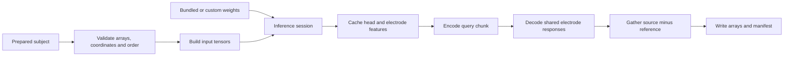

# Code guide

[English](code_guide.md) · [简体中文](../zh/code_guide.md)

Start with [`_spec.py`](../../src/head2field/_spec.py) for the fixed v1 factory,
[`inputs.py`](../../src/head2field/inputs.py) for tensor construction, and
[`inference.py`](../../src/head2field/inference.py) for the prediction flow. The
assembled network is in [`model.py`](../../src/head2field/model.py). All four files
work with the same explicit coordinate and electrode/query identities.

## Package map

| Module | Responsibility |
| --- | --- |
| `_spec.py` | Model variants, fixed pretrained factory, architecture and loss identifiers |
| `weights.py` | Bundled-weight metadata, bare FP32 state-dictionary validation, strict loading |
| `inputs.py` | Head channels, coordinate bundles, query features, stable electrode-pair indexing |
| `model.py` | Coordinate validation, sampling, encoder/FPN, axial mixer, tokens, shared response decoding |
| `inference.py` | One-subject caches, electrode batching, query chunks, ordered predictions |
| `cli.py` | Prediction argument parsing, input verification, output arrays and manifest |
| `preprocessing/` | T1 alignment, CHARM adapter, conductivity, cap, prepared-subject assembly |
| `fem_labels/` | SimNIBS lead-field execution, HDF5 auditing, voxel-label export |
| `training/` | Dataset and cache contracts, loss statistics, physics pools, training and resume |
| `resource_paths.py` | Allowlisted configuration, schema, documentation, and weight resources |

The top-level package exports `Head2FieldV1`, `create_head2field_v1`,
`load_head2field_v1_weights`, and `Head2FieldInferenceSession`. Preprocessing,
FEM, and training execution are reached through their explicit submodules;
optional solver and scientific I/O dependencies are loaded where needed.

## Prediction flow

`predict_prepared_subject_v1()` coordinates the file workflow. The session
holds immutable inputs, evaluates the model in inference mode, and caches the
head FPN, global subject context, electrode tokens, and a bounded number of
query contexts. A new query chunk reuses the head and electrode encodings.

Each pair batch remaps its source/reference indices to a compact electrode
bank before decoding. Repeated references share a token and response inside
that batch. First-occurrence bank order and requested pair order are retained.
This bounds decoder memory without changing the identity of an output field.

Create a new session when changing the subject or model weights. Cached tensors
are computed values and are not refreshed by mutating the original inputs.

## Tensor and coordinate notation

`B` means subjects, `U` unique electrodes, `P` pairs, `Q` queries, and `C`
feature channels. The file-oriented v1 inference workflow uses `B=1`, `U=76`,
and `P=75`; lower-level bundles also support selected or repeated pairs.

| Value | Shape | Meaning |
| --- | --- | --- |
| Canonical tissue/T1/conductivity arrays | `[256,256,256]` | Original 1 mm i/j/k grid |
| Encoder head input | `[B,12,128,128,128]` | Ten tissue channels, normalized conductivity, normalized T1 |
| Query identity | `[B,Q]` | Exact row indices in `gmwm_ijk` |
| Query coordinates | `[B,Q,3]` | Explicit voxel i/j/k, normalized i/j/k, and world-RAS mm fields |
| Native query features | `[B,Q,12]` | Tissue, conductivity, and T1 features from the 1 mm grid |
| Unique electrode coordinates | `[B,U,3]` | Normalized i/j/k and world-RAS mm |
| Pair indices | `[B,P,2]` | Source and reference positions in the unique electrode bank |
| Shared response bank | `[B,U,Q,3]` | `G(head,query,electrode)` |
| Pair fields | `[B,P,Q,3]` | `G(source)-G(reference)` in world-RAS |
| Saved prediction | `[75,Q,3]` | Single-subject pair fields in V/m for the 1 mA convention |

Normalized coordinates use `2 * ijk / (shape - 1) - 1`, matching
`align_corners=True`. The 128-cube encoder preserves the physical bounds of
the 256-cube grid. `sample_volume_at_points()` reverses i/j/k to k/j/i because
PyTorch's sampling grid addresses W/H/D. Affine calculations keep their original
precision even when network execution uses autocast.

The anatomy origin is the mean GM/WM query location. Relative coordinate
features use this origin; absolute coordinate branches receive the controlled
augmentation selected for the current data or physics branch.

## Reading the network

Within `model.py`, follow these stages:

1. `SubjectGeometry`, `QueryCoordinateBundle`, and `ElectrodeCoordinateBundle`
   define and validate identities and coordinate transforms.
2. `AnatomyPyramidEncoder` and `CoarseGlobalAnatomyMixer` produce anatomical
   features. `Head2FieldV1.encode_head()` builds the four-level FPN.
3. `build_global_context()`, `encode_queries()`, and
   `encode_unique_electrodes()` form subject, query, and electrode tokens.
4. `decode_response_bank()` applies electrode-conditioned decoding once per
   unique electrode. `gather_pair_field()` performs source-minus-reference
   subtraction using explicit pair indices.
5. `forward_bundled()` evaluates one branch.
   `forward_data_and_physics()` shares the head encoding across two branches.

The shared bank gives antisymmetry and additive pair identities through the
same subtraction rule. Individual `G` values have an unidentifiable additive
gauge. Supervised targets and physical operators apply to bipolar pair fields.
The fixed architecture settings are detailed in [model architecture](model_architecture.md).

## Reading the training path

[`training/cli.py`](../../src/head2field/training/cli.py) validates the execution
profile and constructs the dataset, complete-epoch sampler, run contract,
step function, and runner. The responsibilities are:

| File | Responsibility |
| --- | --- |
| `contracts.py` | Validate training configuration and metadata the run contract |
| `dataset.py` | Verify dataset assets and build supervised/physics tensor bundles |
| `cache.py` | Prepare query-major targets and full-field energy statistics |
| `physics_data.py` | Prepare primitive pools and training-only FEM calibration |
| `losses.py` | Global, radial, and high-field stable-energy supervision |
| `physics.py` | Integral operators and calibrated one-sided excess losses |
| `steps.py` | Share model encoding, combine data/physics losses, apply the curriculum |
| `runner.py` | AMP, backward, gradient clipping, optimizer/scheduler, epoch logging |
| `validation.py` | Deterministic validation and final test evaluation |
| `state.py` | Complete local resume state and independent RNG streams |

The data branch uses named augmentation and dropout generators. The physics
branch uses identity augmentation and consumes no data RNG. Operator validity
masks and calibration remain fixed from prepared FEM assets. Global, radial,
and high-field loss denominators describe the complete subject fields; query
chunks only contribute their error numerators. Huber, MAE, and relative L2 in
the supervised-loss metrics are diagnostics.

See [training](training.md) for runnable commands and checkpoint contents.

## Editing and verification

Keep parameter names/shapes, input transforms, source/query order, coordinate
frames, units, and scientific defaults explicit. Model factory changes affect
the pretrained-weight schema; a model version change needs its corresponding
factory, configuration, and loader. Package and data-schema versions are
tracked independently.

For a readability refactor, use the existing small-model tests and compare the
same inputs before and after. Changes to source/query indexing need checks for
reordering, repeated IDs, shared references, and partial chunks. Loss changes
need value and gradient comparisons. See [CONTRIBUTING.md](../../CONTRIBUTING.md)
for development commands and focused verification.

Public comments, docstrings, and CLI help use English. Keep every English guide
aligned with its Chinese companion, including commands and scientific settings.
After updating a shipped document, synchronize its copy in
`src/head2field/resources/`; existing packaging tests verify the copies byte
for byte.
