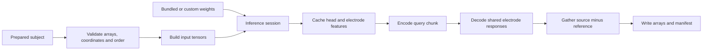

# Code guide

[English](code_guide.md) · [简体中文](../zh/code_guide.md)

To follow a prediction through the code, read the model factory in
[`_spec.py`](../../src/head2field/_spec.py), tensor construction in
[`inputs.py`](../../src/head2field/inputs.py), and the inference workflow in
[`inference.py`](../../src/head2field/inference.py). The network itself is in
[`model.py`](../../src/head2field/model.py). Coordinates, electrode order, and
query-row indices have the same meaning throughout these files.

## Package map

| Module | Responsibility |
| --- | --- |
| `_spec.py` | Model variants, fixed pretrained factory, architecture and loss identifiers |
| `weights.py` | Bundled-weight metadata, bare FP32 state-dictionary validation, strict loading |
| `inputs.py` | Head channels, coordinate bundles, query features, stable electrode-pair indexing |
| `model.py` | Coordinate validation, sampling, encoder/FPN, axial mixer, tokens, shared response decoding |
| `inference.py` | One-subject caches, electrode batching, query chunks, ordered predictions |
| `cli.py` | Prediction argument parsing, input verification, output arrays and manifest |
| `preprocessing/` | T1 alignment, CHARM adapter, conductivity, cap, prepared-subject assembly |
| `fem_labels/` | SimNIBS lead-field execution, HDF5 auditing, voxel-label export |
| `training/` | Dataset and cache formats, loss statistics, physics pools, training and resume |
| `resource_paths.py` | Allowlisted configuration, schema, documentation, and weight resources |

The top-level API provides `Head2FieldV1`, `create_head2field_v1`,
`load_head2field_v1_weights`, and `Head2FieldInferenceSession`. Preprocessing,
FEM, and training have separate submodules. Solver and scientific I/O
dependencies load only when the corresponding feature is called.

## Prediction flow

`predict_prepared_subject_v1()` reads the prepared subject and writes prediction
files. Its session holds fixed inputs and runs the model in inference mode.
The head FPN, global subject context, electrode tokens, and a limited number
of query contexts are cached, so each new query chunk can reuse the head and
electrode encodings.

For each pair batch, the decoder builds a compact bank containing only the
electrodes that batch needs. Pairs with a shared reference reuse its token and
response. The bank keeps first-occurrence order, and the output keeps the
requested pair order. This reduces decoder memory use.

Create a new session for a different subject or different weights. Changing
the original inputs does not update values already cached by a session.

## Tensor and coordinate notation

In the shapes below, `B` is the number of subjects, `U` unique electrodes,
`P` electrode pairs, `Q` query points, and `C` feature channels. Prediction
from a prepared-subject directory uses `B=1`, `U=76`, and `P=75`. Lower-level
bundles can also contain selected or repeated pairs.

| Value | Shape | Meaning |
| --- | --- | --- |
| Canonical tissue/T1/conductivity arrays | `[256,256,256]` | Original 1 mm i/j/k grid |
| Encoder head input | `[B,12,128,128,128]` | Ten tissue channels, normalized conductivity, normalized T1 |
| Query row indices | `[B,Q]` | Exact row indices in `gmwm_ijk` |
| Query coordinates | `[B,Q,3]` | Voxel i/j/k, normalized i/j/k, and world-RAS mm fields |
| Native query features | `[B,Q,12]` | Tissue, conductivity, and T1 features from the 1 mm grid |
| Unique electrode coordinates | `[B,U,3]` | Normalized i/j/k and world-RAS mm |
| Pair indices | `[B,P,2]` | Source and reference positions in the unique electrode bank |
| Shared response bank | `[B,U,Q,3]` | `G(head,query,electrode)` |
| Pair fields | `[B,P,Q,3]` | `G(source)-G(reference)` in world-RAS |
| Saved prediction | `[75,Q,3]` | Single-subject pair fields in V/m for the 1 mA convention |

Coordinates are normalized with `2 * ijk / (shape - 1) - 1`, matching
`align_corners=True`. The 128-cube encoder input covers the same physical
bounds as the 256-cube grid. `sample_volume_at_points()` reverses i/j/k to
k/j/i to match PyTorch's W/H/D sampling order. Affine calculations retain
their original precision when the network uses autocast.

Relative coordinates use the mean GM/WM query location as their origin.
The absolute-coordinate branches use the augmentation settings of the current
data or physics branch.

## Reading the network

Read `model.py` in the following order:

1. `SubjectGeometry`, `QueryCoordinateBundle`, and `ElectrodeCoordinateBundle`
   store electrode/query indices and validate coordinate transforms.
2. `AnatomyPyramidEncoder` and `CoarseGlobalAnatomyMixer` produce anatomical
   features. `Head2FieldV1.encode_head()` builds the four-level FPN.
3. `build_global_context()`, `encode_queries()`, and
   `encode_unique_electrodes()` form subject, query, and electrode tokens.
4. `decode_response_bank()` applies electrode-conditioned decoding once per
   unique electrode. `gather_pair_field()` performs source-minus-reference
   subtraction using the supplied pair indices.
5. `forward_bundled()` evaluates one branch.
   `forward_data_and_physics()` shares the head encoding across two branches.

Subtracting shared responses gives antisymmetric and additive pair fields.
Adding the same vector to all electrode responses at one query point leaves
their differences unchanged, so supervision and physics losses act on pair
fields. Network settings are described in [model architecture](model_architecture.md).

## Reading the training path

[`training/cli.py`](../../src/head2field/training/cli.py) checks the execution
configuration, then creates the dataset, complete-epoch sampler, run settings,
step function, and runner. The main files are:

| File | Responsibility |
| --- | --- |
| `contracts.py` | Validate training configuration and record the complete training run settings |
| `dataset.py` | Verify dataset files and build supervised/physics tensor bundles |
| `cache.py` | Prepare query-major targets and full-field energy statistics |
| `physics_data.py` | Prepare integration sample sets and training-only FEM calibration |
| `losses.py` | Global, radial, and high-field stable-energy supervision |
| `physics.py` | Integral operators and calibrated one-sided excess losses |
| `steps.py` | Share model encoding, combine data/physics losses, apply the curriculum |
| `runner.py` | AMP, backward, gradient clipping, optimizer/scheduler, epoch logging |
| `validation.py` | Deterministic validation and final test evaluation |
| `state.py` | Complete local resume state and independent RNG streams |

Separate random-number generators control augmentation and dropout in the data
branch. The physics branch uses unaugmented coordinates and does not consume
the data generator. Its valid samples and calibration come from prepared FEM
data and remain fixed.

Global, radial, and high-field denominators are computed from each subject's
complete fields. A query chunk contributes only its error numerator. The
supervised-loss output also reports Huber, MAE, and relative L2 as diagnostics.

See [training](training.md) for runnable commands and checkpoint contents.

## Editing and verification

When changing code, check parameter names and shapes, input processing,
source/query order, coordinate frames, units, and default settings. A change
to the model factory can affect weight compatibility; a new model version
needs a matching factory, configuration, and loader. Package and data-format
versions are managed separately.

For a readability refactor, compare the same inputs before and after using
the existing small-model tests. If source or query indexing changes, include
reordering, repeated IDs, shared references, and partial chunks. If a loss
changes, compare both values and gradients. Development commands are in
[CONTRIBUTING.md](../CONTRIBUTING.md).

Use English for public API names and CLI help, and Chinese for new source
comments and docstrings. Keep the English and Chinese guides consistent,
including commands and scientific settings. When editing a shipped document,
update its copy in `src/head2field/resources/` too; the packaging tests compare
these copies byte for byte.
