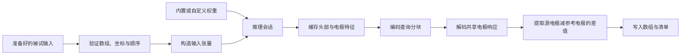

# 代码阅读指南

[English](../en/code_guide.md) · [简体中文](code_guide.md)

沿预测流程阅读代码时，可依次查看 [`_spec.py`](../../src/head2field/_spec.py) 中的模型创建函数、[`inputs.py`](../../src/head2field/inputs.py) 中的张量构建，以及 [`inference.py`](../../src/head2field/inference.py) 中的推理流程。网络本身位于 [`model.py`](../../src/head2field/model.py)。这些文件中的坐标、电极顺序和查询行索引含义一致。

## 软件包结构

| 模块 | 职责 |
| --- | --- |
| `_spec.py` | 模型创建函数、结构参数和损失名称 |
| `weights.py` | 内置权重校验、裸 FP32 state dictionary 验证及严格加载 |
| `inputs.py` | 头部通道、坐标 bundle、查询特征及稳定的电极对索引 |
| `model.py` | 坐标验证、采样、编码器/FPN、轴向 mixer、token 与共享响应解码 |
| `inference.py` | 单被试缓存、电极批次、查询分块及有序预测 |
| `cli.py` | 预测参数解析、输入验证、输出数组及清单 |
| `preprocessing/` | T1 对齐、CHARM adapter、电导率、cap 及 prepared subject 组装 |
| `fem_labels/` | SimNIBS 先导场执行、HDF5 审计和体素标签导出 |
| `training/` | 训练数据与缓存格式、损失统计、物理损失采样数据、训练及恢复 |
| `resource_paths.py` | 访问随包配置、schema、文档和权重文件 |

顶层 API 提供 `Head2FieldV1`、`create_head2field_v1`、`load_head2field_v1_weights` 和 `Head2FieldInferenceSession`。预处理、FEM 和训练放在独立子模块中，调用相应功能时才加载求解器或科学数据读写依赖。

## 预测流程

`predict_prepared_subject_v1()` 读取被试输入并写出预测文件。推理会话保存固定输入，以推理模式运行模型，缓存头部 FPN、全局被试特征、电极 token 和有限数量的查询特征。后续分块可以直接复用头部与电极编码。

解码每个电极对批次时，程序先建立仅包含所需电极的紧凑电极库。共用参考电极的电极对复用同一特征和响应。电极库保持首次出现顺序，输出保持请求的电极对顺序，从而减少解码器内存占用。

切换被试或权重时，请创建新会话。修改原始输入不会更新会话中已缓存的数值。

## 张量与坐标记号

下表中，`B` 为被试数，`U` 为唯一电极数，`P` 为电极对数，`Q` 为查询点数，`C` 为特征通道数。从被试输入目录预测时，使用 `B=1`、`U=76`、`P=75`；底层 bundle 还可以包含选定或重复的电极对。

| 数据 | 形状 | 含义 |
| --- | --- | --- |
| Canonical 组织/T1/电导率数组 | `[256,256,256]` | 原始 1 mm i/j/k 网格 |
| 编码器头部输入 | `[B,12,128,128,128]` | 十种组织、归一化电导率与 T1 |
| 查询行索引 | `[B,Q]` | `gmwm_ijk` 中的精确行索引 |
| 查询坐标 | `[B,Q,3]` | 体素 i/j/k、归一化 i/j/k 和 world-RAS mm 字段 |
| 原始网格查询特征 | `[B,Q,12]` | 来自 1 mm 网格的组织、电导率与 T1 特征 |
| 唯一电极坐标 | `[B,U,3]` | 归一化 i/j/k 及 world-RAS mm |
| 电极对索引 | `[B,P,2]` | 唯一电极库中的源和参考位置 |
| 共享响应库 | `[B,U,Q,3]` | `G(head,query,electrode)` |
| 电极对电场 | `[B,P,Q,3]` | world-RAS 中的 `G(source)-G(reference)` |
| 保存的预测 | `[75,Q,3]` | 单被试电极对电场，采用 1 mA 约定，单位 V/m |

坐标按 `2 * ijk / (shape - 1) - 1` 归一化，对应 `align_corners=True`。128³ 编码器输入覆盖与 256³ 网格相同的物理范围。`sample_volume_at_points()` 将 i/j/k 反转为 k/j/i，匹配 PyTorch 的 W/H/D 采样顺序。网络使用 autocast 时，仿射计算仍保持原精度。

相对坐标以 GM/WM 查询位置的均值为原点，绝对坐标分支则使用当前数据分支或物理分支的增强设置。

## 阅读网络

建议按以下顺序阅读 `model.py`：

1. `SubjectGeometry`、`QueryCoordinateBundle` 和 `ElectrodeCoordinateBundle` 保存电极和查询点索引，并检查坐标转换。
2. `AnatomyPyramidEncoder` 与 `CoarseGlobalAnatomyMixer` 生成解剖特征；`Head2FieldV1.encode_head()` 构建四层 FPN。
3. `build_global_context()`、`encode_queries()` 和 `encode_unique_electrodes()` 生成被试、查询及电极 token。
4. `decode_response_bank()` 对每个唯一电极执行共享解码；`gather_pair_field()` 根据电极对索引计算源响应与参考响应之差。
5. `forward_bundled()` 评估一个分支；`forward_data_and_physics()` 为两个分支共享头部编码。

共享响应相减使电极对电场满足反对称和可加关系。在同一查询点上，所有电极响应加上同一向量不会改变它们的差，因此监督损失与物理损失都作用于电极对电场。网络设置见[模型结构](model_architecture.md)。

## 阅读训练路径

[`training/cli.py`](../../src/head2field/training/cli.py) 检查执行配置后，创建数据集、完整 epoch 采样器、运行设置、step 函数和训练器。主要文件如下：

| 文件 | 职责 |
| --- | --- |
| `contracts.py` | 验证训练配置并保存完整运行配置和数据划分 |
| `dataset.py` | 验证数据文件，构建监督/物理张量 bundle |
| `cache.py` | 准备 query-major 目标和完整电场能量统计 |
| `physics_data.py` | 准备积分采样数据及仅由训练数据拟合的 FEM 校准 |
| `losses.py` | 全局、径向及高场稳定能量监督 |
| `physics.py` | 积分算子和校准的单侧超额损失 |
| `steps.py` | 共享编码、组合数据/物理损失及应用 curriculum |
| `runner.py` | AMP、反向传播、裁剪、优化器/调度器及 epoch 日志 |
| `validation.py` | 按固定顺序验证并进行最终测试 |
| `state.py` | 完整本地恢复状态及独立 RNG 流 |

数据分支分别用独立随机数生成器控制增强和 dropout。物理分支使用未增强的坐标，不消耗数据分支的随机数；其有效采样位置和校准值由准备好的 FEM 数据确定，训练中保持不变。

全局、径向和高场损失的分母根据被试完整电场计算，查询分块只贡献对应误差的分子。监督损失输出还包含 Huber、MAE 和相对 L2，供观察训练过程。

运行命令及 checkpoint 内容见[训练说明](training.md)。

## 修改与验证

修改代码时，检查参数名和形状、输入处理、源与查询顺序、坐标系、单位以及默认设置。模型创建函数的变化可能影响权重兼容性；新增模型版本时，需要匹配的创建函数、配置和加载器。软件版本和数据格式版本分别管理。

调整代码可读性时，可用已有小模型测试对比改动前后的同一输入。修改源或查询索引时，覆盖重排、重复 ID、共享参考和末尾不完整分块；修改损失时，同时比较数值与梯度。开发命令见[贡献指南](../CONTRIBUTING_zh.md)。

代码、注释、docstring、公开 API 名称、CLI 信息和主文档均使用英文，中文文档作为对应翻译提供。中英文指南的命令与科学设置保持一致。修改随包文档时，也更新 `src/head2field/resources/` 中的副本；打包测试会逐字节比较这些文件。
