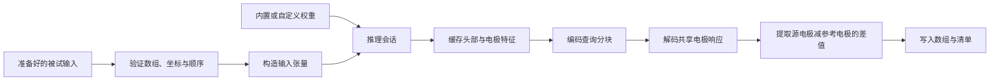

# 代码阅读指南

[English](../en/code_guide.md) · [简体中文](code_guide.md)

先阅读固定 v1 工厂所在的 [`_spec.py`](../../src/head2field/_spec.py)、负责张量构建的 [`inputs.py`](../../src/head2field/inputs.py) 和组织预测流程的 [`inference.py`](../../src/head2field/inference.py)。完整网络位于 [`model.py`](../../src/head2field/model.py)。四个文件共享显式坐标及电极/查询身份约定。

## 软件包结构

| 模块 | 职责 |
| --- | --- |
| `_spec.py` | 模型变体、固定预训练工厂、结构及损失标识 |
| `weights.py` | 内置权重校验、裸 FP32 state dictionary 验证及严格加载 |
| `inputs.py` | 头部通道、坐标 bundle、查询特征及稳定的电极对索引 |
| `model.py` | 坐标验证、采样、编码器/FPN、轴向 mixer、token 与共享响应解码 |
| `inference.py` | 单被试缓存、电极批次、查询分块及有序预测 |
| `cli.py` | 预测参数解析、输入验证、输出数组及清单 |
| `preprocessing/` | T1 对齐、CHARM adapter、电导率、cap 及 prepared subject 组装 |
| `fem_labels/` | SimNIBS 先导场执行、HDF5 审计和体素标签导出 |
| `training/` | 数据与缓存合同、损失统计、物理池、训练及恢复 |
| `resource_paths.py` | 允许列表中的配置、schema、文档和权重资源 |

顶层包导出 `Head2FieldV1`、`create_head2field_v1`、`load_head2field_v1_weights` 和 `Head2FieldInferenceSession`。预处理、FEM 和训练通过显式子模块访问；可选求解器与科学 I/O 依赖仅在需要时加载。

## 预测流程

`predict_prepared_subject_v1()` 组织文件处理流程。session 持有不可变输入，以推理模式运行模型，缓存头部 FPN、全局被试上下文、电极 token 和有限数量的查询上下文。新查询分块复用已有头部和电极编码。

每个电极对批次在解码前，将源/参考索引重映射到紧凑电极库。重复参考在该批次内共享 token 与响应，保留电极首次出现顺序及请求的电极对顺序，从而限制解码内存，并保持输出电场身份。

切换被试或模型权重时建立新 session。缓存是已计算张量，修改原始输入不会自动更新它们。

## 张量与坐标记号

`B` 表示被试、`U` 表示唯一电极、`P` 表示电极对、`Q` 表示查询、`C` 表示特征通道。文件级 v1 推理采用 `B=1`、`U=76`、`P=75`；底层 bundle 也支持选定或重复电极对。

| 数据 | 形状 | 含义 |
| --- | --- | --- |
| Canonical 组织/T1/电导率数组 | `[256,256,256]` | 原始 1 mm i/j/k 网格 |
| 编码器头部输入 | `[B,12,128,128,128]` | 十种组织、归一化电导率与 T1 |
| 查询身份 | `[B,Q]` | `gmwm_ijk` 中的精确行索引 |
| 查询坐标 | `[B,Q,3]` | 显式体素 i/j/k、归一化 i/j/k 和 world-RAS mm 字段 |
| 原始网格查询特征 | `[B,Q,12]` | 来自 1 mm 网格的组织、电导率与 T1 特征 |
| 唯一电极坐标 | `[B,U,3]` | 归一化 i/j/k 及 world-RAS mm |
| 电极对索引 | `[B,P,2]` | 唯一电极库中的源和参考位置 |
| 共享响应库 | `[B,U,Q,3]` | `G(head,query,electrode)` |
| 电极对电场 | `[B,P,Q,3]` | world-RAS 中的 `G(source)-G(reference)` |
| 保存的预测 | `[75,Q,3]` | 单被试电极对电场，采用 1 mA 约定，单位 V/m |

归一化坐标采用 `2 * ijk / (shape - 1) - 1`，对应 `align_corners=True`。128³ 编码器保留 256³ 网格的物理边界。`sample_volume_at_points()` 将 i/j/k 反转为 k/j/i，以适应 PyTorch 采样网格的 W/H/D 顺序。即使网络使用 autocast，仿射计算仍保留原精度。

解剖原点为 GM/WM 查询位置的均值。相对坐标特征以此为原点；绝对坐标分支接受当前数据或物理分支指定的受控增强。

## 阅读网络

在 `model.py` 中依次阅读：

1. `SubjectGeometry`、`QueryCoordinateBundle` 和 `ElectrodeCoordinateBundle` 定义并验证身份及坐标变换。
2. `AnatomyPyramidEncoder` 与 `CoarseGlobalAnatomyMixer` 生成解剖特征；`Head2FieldV1.encode_head()` 构建四层 FPN。
3. `build_global_context()`、`encode_queries()` 和 `encode_unique_electrodes()` 生成被试、查询及电极 token。
4. `decode_response_bank()` 对每个唯一电极执行共享解码；`gather_pair_field()` 根据显式电极对索引执行源减参考。
5. `forward_bundled()` 评估一个分支；`forward_data_and_physics()` 为两个分支共享头部编码。

共享响应库通过同一相减规则保证反对称和电极对可加关系。单独的 `G` 具有不可辨识的加性规范自由度；监督目标和物理算子作用于双极电极对电场。固定结构参数见[模型结构](model_architecture.md)。

## 阅读训练路径

[`training/cli.py`](../../src/head2field/training/cli.py) 验证执行配置，建立数据集、完整 epoch 采样器、运行合同、step 函数及训练器。职责如下：

| 文件 | 职责 |
| --- | --- |
| `contracts.py` | 验证训练配置并保存完整运行配置和数据划分 |
| `dataset.py` | 验证数据资产，构建监督/物理张量 bundle |
| `cache.py` | 准备 query-major 目标和完整电场能量统计 |
| `physics_data.py` | 准备原语池及仅由训练数据拟合的 FEM 校准 |
| `losses.py` | 全局、径向及高场稳定能量监督 |
| `physics.py` | 积分算子和校准的单侧超额损失 |
| `steps.py` | 共享编码、组合数据/物理损失及应用 curriculum |
| `runner.py` | AMP、反向传播、裁剪、优化器/调度器及 epoch 日志 |
| `validation.py` | 确定性验证和最终测试评估 |
| `state.py` | 完整本地恢复状态及独立 RNG 流 |

数据分支使用命名的增强和 dropout generator。物理分支使用恒等增强，不消耗数据 RNG。算子有效掩膜与校准由 prepared FEM 资产固定。全局、径向和高场损失分母描述完整被试电场，查询分块仅贡献误差分子。监督损失指标中的 Huber、MAE 和相对 L2 仅作诊断。

运行命令及 checkpoint 内容见[训练说明](training.md)。

## 修改与验证

明确保留参数名与形状、输入变换、源/查询顺序、坐标系、单位和科学默认值。模型工厂变化会影响预训练权重 schema；模型版本变化需要对应工厂、配置和加载器。软件包与数据 schema 版本分别跟踪。

可读性重构应使用已有小模型测试，对比改动前后同一输入。源/查询索引变化应检查重排、重复 ID、共享参考和末尾不完整分块；损失变化应比较数值和梯度。开发命令与针对性验证见[贡献指南](../CONTRIBUTING_zh.md)。

公开 API 名称和 CLI 帮助使用英文，新增源码注释与 docstring 使用中文。每篇英文指南应与中文版本对齐，包括命令和科学设置。更新随包文档后，同步 `src/head2field/resources/` 副本；已有打包测试逐字节核对这些副本。
